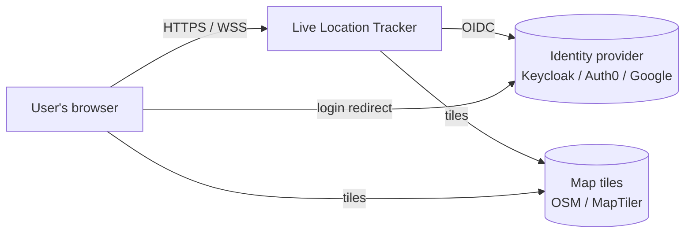
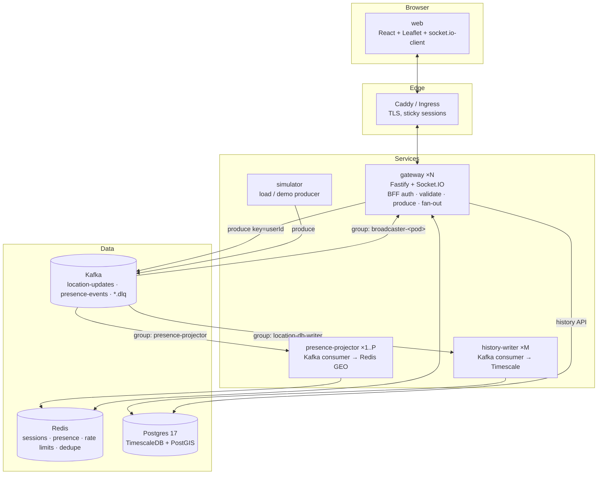
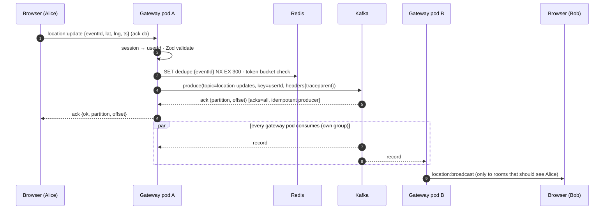
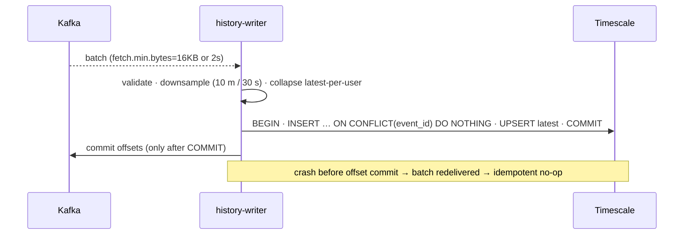

# Live Location Tracker: Complete Engineering Plan

> All 13 plan documents from `docs/plan/` combined into one file. The separate files are unchanged.
> Status: Approved, v1 in progress (see docs/STATUS.md) · Plan date: 2026-11-25 · Submission deadline: 2026-12-31

## Table of contents

| # | Document |
|---|---|
| 00 | [Overview & stack summary](#doc-00) |
| 01 | [Requirements & capacity](#doc-01) |
| 02 | [Tech stack & architecture decisions](#doc-02) |
| 03 | [System architecture](#doc-03) |
| 04 | [Kafka & event streaming](#doc-04) |
| 05 | [Realtime gateway](#doc-05) |
| 06 | [Auth & security](#doc-06) |
| 07 | [Data storage](#doc-07) |
| 08 | [Frontend](#doc-08) |
| 09 | [Observability & reliability](#doc-09) |
| 10 | [Infrastructure & DevOps](#doc-10) |
| 11 | [Testing strategy](#doc-11) |
| 12 | [Roadmap & demo script](#doc-12) |


---

<a id="doc-00"></a>

# Live Location Tracker: Engineering Plan

> Status: **Approved, v1 in progress (Phase 0 done 2026-11-26, CI green)** · Plan date: 2026-11-25 · Submission deadline: 2026-12-31
> The current JavaScript prototype in this repo stays as-is. It becomes the reference implementation (`v0-prototype`) while v1 is built next to it (see [12-roadmap.md](#doc-12)).

## 1. What we are building

A real-time location platform, the same shape as rider/customer tracking in Uber, Swiggy or Zomato:

- users sign in with **OIDC**, grant location permission, and stream their position
- every update goes **Socket.IO → Kafka → consumers**. One consumer group fans updates out to live maps; another persists history
- the map (**Leaflet**) shows everyone's live markers moving smoothly, removes stale users, and can replay history

## 2. Guiding principles

1. **Kafka is the backbone.** No location reaches another user or the database without passing through the log.
2. **Identity comes from the session, never from the payload.** `userId` = OIDC `sub`.
3. **Every write is idempotent.** Assume at-least-once delivery everywhere and make duplicates harmless.
4. **Separate the hot path from the cold path.** Live fan-out (milliseconds) never waits for the database.
5. **Build only what we can explain.** Every component has to be explainable in the demo video. If we can't explain it, we don't add it.
6. **Do the boring thing first.** Pick well-proven tools and add complexity only when a number justifies it.

## 3. The stack in one table

| Concern | Choice | Doc |
|---|---|---|
| Language | **TypeScript** end to end (Node.js 22 LTS) | [02](#doc-02) |
| Repo | **npm workspaces + Turborepo** monorepo (changed from pnpm, see ADR-02) | [10](#doc-10) |
| Frontend | **React 19 + Vite**, **Leaflet** (react-leaflet), TanStack Query, Zustand, Tailwind + shadcn/ui | [08](#doc-08) |
| Realtime gateway | **Fastify + Socket.IO** | [05](#doc-05) |
| Event streaming | **Apache Kafka 4 (KRaft)** · client **@confluentinc/kafka-javascript** | [04](#doc-04) |
| Event contracts | **Zod** schemas in a shared package, versioned envelope (Protobuf + Schema Registry later) | [04](#doc-04) |
| Auth | **OIDC Auth Code + PKCE, BFF pattern** (HttpOnly session cookie) · **Keycloak** locally, Auth0/Google in prod | [06](#doc-06) |
| Hot state | **Redis 7 / Valkey**: sessions, presence (GEO), rate limits, dedupe | [07](#doc-07) |
| Durable store | **PostgreSQL 17 + PostGIS + TimescaleDB** (hypertables, compression, retention) · **Drizzle ORM** | [07](#doc-07) |
| Observability | **OpenTelemetry** (traces through Kafka headers) · **Prometheus + Grafana + Loki** · **pino** logs | [09](#doc-09) |
| Testing | **Vitest**, **Testcontainers** (Kafka/Postgres/Redis/Keycloak), **Playwright** (geolocation mocking), **Artillery** load tests | [11](#doc-11) |
| Local/infra | **Docker Compose** · deploy on a VM with **Caddy** TLS · production target **Kubernetes + Strimzi** | [10](#doc-10) |

## 4. Document map

| # | Document | Answers |
|---|---|---|
| 01 | [Requirements & capacity](#doc-01) | What must it do, how big, how fast? |
| 02 | [Tech stack & decisions](#doc-02) | Why each tool, what we rejected |
| 03 | [System architecture](#doc-03) | Components, data flows, diagrams |
| 04 | [Kafka & event streaming](#doc-04) | Topics, keys, partitions, groups, schemas, delivery semantics |
| 05 | [Realtime gateway](#doc-05) | Socket protocol, scaling, fan-out, backpressure |
| 06 | [Auth & security](#doc-06) | OIDC flow, socket auth, threat model |
| 07 | [Data storage](#doc-07) | Redis + Postgres/Timescale schema, write strategy, retention |
| 08 | [Frontend](#doc-08) | App structure, map rendering, UX states |
| 09 | [Observability & reliability](#doc-09) | SLOs, metrics, tracing, failure modes |
| 10 | [Infrastructure & DevOps](#doc-10) | Repo layout, CI/CD, environments, deployment |
| 11 | [Testing strategy](#doc-11) | Test pyramid, what each level proves |
| 12 | [Roadmap](#doc-12) | Week-by-week plan to Dec 31, scope tiers, demo script |

## 5. Scope tiers

"World-class" includes knowing what *not* to build before a deadline.

| Tier | Meaning | Examples |
|---|---|---|
| **MUST** | Graded; must be built and shown in the demo | OIDC, Socket.IO auth, Kafka producer + 2 consumer groups, Leaflet live map, history persistence, disconnect/invalid/duplicate handling, README, demo |
| **SHOULD** | Makes it industry-grade; build if on schedule | TypeScript monorepo, Redis presence, TimescaleDB, OpenTelemetry traces, Testcontainers, Playwright, CI, deployed URL |
| **COULD** | Designed and documented, built only if time remains | Viewport/H3-based subscriptions, DLQ replay tool, Protobuf + Schema Registry, Kubernetes manifests, history playback |
| **WON'T (now)** | Explicitly out of scope | Native mobile apps, ETA/routing, payments, multi-region active-active |

The evaluation rubric names **Leaflet**, **Socket.IO** and **Kafka** explicitly, so those three are fixed choices, not open for debate.


---

<a id="doc-01"></a>

# 01 · Requirements & Capacity

## Functional requirements

| ID | Requirement | Tier |
|---|---|---|
| F1 | Users sign in via OIDC / OAuth 2.0; signing out ends the IdP session too | MUST |
| F2 | Only authenticated users can open a socket or send locations | MUST |
| F3 | The browser asks for location permission and handles granted / denied / unavailable | MUST |
| F4 | The client sends location at a controlled interval (default 3 s, plus a heartbeat when stationary) | MUST |
| F5 | The gateway validates, deduplicates and rate-limits, then publishes to `location-updates` | MUST |
| F6 | A broadcaster consumer group pushes updates to connected clients | MUST |
| F7 | A separate DB-processor consumer group persists history using batched writes | MUST |
| F8 | The map shows markers per user; the current user is visually distinct; markers glide between positions | MUST |
| F9 | Stale or disconnected users are removed from every map | MUST |
| F10 | A user can view their own stored history trail | SHOULD |
| F11 | Viewport-scoped updates: a client receives only users inside its map bounds | COULD |
| F12 | History playback (scrub a timeline) | COULD |
| F13 | Sharing visibility controls (everyone / group / nobody) | COULD |

## Non-functional requirements

| Category | Target |
|---|---|
| **Latency** | p50 < 150 ms, p99 < 500 ms **end to end** (sender emit → other clients' marker update) |
| **Throughput (design)** | 100k concurrent sharers × 1 msg / 3 s ≈ **33k events/s** sustained, 3× burst |
| **Throughput (demo)** | 10–1,000 simulated users on one VM |
| **Availability** | 99.9% for live tracking; history persistence may lag but must not lose data |
| **Durability** | No acknowledged event lost (`acks=all`, `min.insync.replicas=2` in production) |
| **Freshness** | A user is removed from maps ≤ 35 s after their last update |
| **Privacy** | Locations are visible only to authenticated users; history only to its owner; raw history retained for 30 days |
| **Security** | OWASP ASVS L2 controls for session, input validation, transport |
| **Operability** | Every component exposes health, metrics and traces; consumer lag is visible |

## Capacity math (design target)

```
Sharers:                 100,000 concurrent
Send interval:           3 s           → 33,333 events/s
Event size (JSON, gzip): ~250 B raw, ~120 B compressed
Kafka ingress:           33k × 250 B ≈ 8.3 MB/s raw (~4 MB/s compressed)
Kafka retention 24 h:    ~350 GB raw per replica (~170 GB compressed) → fine for 3 brokers
Partitions:              24  (≈1.4k events/s per partition; leaves room for 24 consumer instances)

History after downsampling (keep a point if moved ≥10 m or ≥30 s):
  ~40% of events kept    → ~13k rows/s → ~1.1 B rows/day
  TimescaleDB compression (~10–20×) → ~60–90 GB/day on disk → 30-day retention ≈ 2–3 TB

Fan-out (the real bottleneck):
  Naive "everyone sees everyone": 33k events/s × 100k viewers = 3.3 B socket msgs/s → impossible
  Viewport-scoped (each viewer sees ~50 users): 100k × 50 / 3 s ≈ 1.7 M msgs/s
     → ~35 gateway pods at ~50k msgs/s each
```

**Conclusion:** at scale, the fan-out pattern matters more than Kafka throughput. Phase 1 broadcasts to everyone, which is correct for the assignment and demo size. The architecture is designed so viewport-scoped rooms (H3 cells, see [05](#doc-05)) can be added without changing the event contracts.

## Constraints & assumptions

- Browser-only clients (secure context required: HTTPS or `localhost`).
- Single region. Clock skew between client and server is tolerated up to ±60 s; ordering uses **server** time.
- The assignment rubric fixes the choice of **Leaflet**, **Socket.IO** and **Kafka**.
- One developer, about 5 weeks until submission.


---

<a id="doc-02"></a>

# 02 · Tech Stack & Architecture Decisions

Each decision below is written as a short ADR: **choice → why → rejected alternatives → when to revisit.**

---

## ADR-01 · TypeScript everywhere (Node.js 22 LTS)
- **Why:** one language and one set of shared types for client, gateway, consumers and event schemas. A field renamed in the event contract breaks compilation in all four places instead of failing at runtime in production. Node's event loop is a natural fit for I/O-bound socket gateways.
- **Rejected:** *Go* (better raw CPU/memory per connection, but you lose the shared types and Socket.IO's reference server is Node); *Elixir/Phoenix* (excellent for presence, but adds a second ecosystem and the rubric expects Socket.IO); plain JS (the current prototype; fine for a prototype, risky as it grows).
- **Revisit when:** a single gateway pod needs > 100k connections and CPU profiles show JSON/socket overhead dominating. Then consider a Go gateway that speaks the Socket.IO protocol or uses raw WebSockets.

## ADR-02 · Monorepo: npm workspaces + Turborepo
- **Decision changed 2026-11-25:** the plan first chose pnpm; v1 uses **npm workspaces** (npm 11) instead. Reasons: the owner asked for npm, the prototype already has an npm lockfile, and native add-ons such as the Confluent Kafka client install more predictably with npm on Windows. pnpm's stricter dependency isolation is the trade-off we give up.
- **Why a monorepo:** apps (`web`, `gateway`, `history-writer`, `presence-projector`, `simulator`) and packages (`contracts`, `config`, `kafka`, `observability`) version together. Turborepo caches builds and tests.
- **Rejected:** Nx (more powerful but heavier than this project needs); polyrepo (contract changes would need coordinated releases).

## ADR-03 · Frontend: React 19 + Vite SPA, Leaflet via react-leaflet
- **Why:** the app sits entirely behind login and is a live, stateful map, so there's nothing to gain from SSR or SEO. Vite gives instant HMR and a static build that any CDN can serve. **Leaflet is named in the rubric.** react-leaflet gives declarative layers, and for performance we drive markers imperatively through refs (see [08](#doc-08)).
- **Supporting libraries:** TanStack Query (REST data: me, history), Zustand (live presence store, which updates many times per second without re-rendering the whole tree), Tailwind CSS + shadcn/ui (accessible components we own), Leaflet canvas renderer + supercluster for many markers.
- **Rejected:** Next.js (SSR and server components add complexity a map SPA doesn't need, and websocket handling in serverless deployments is awkward); MapLibre GL (better at 10k+ markers with WebGL vector tiles, but the rubric asks for Leaflet; noted as an upgrade path); Redux (too much ceremony for this state).

## ADR-04 · Gateway: Fastify + Socket.IO
- **Why:** Fastify is the fastest mainstream Node HTTP framework, with schema-validated routes, a solid plugin system and first-class TypeScript. Socket.IO gives acks, automatic reconnection, rooms, a polling fallback for corporate proxies, and is required by the rubric.
- **Rejected:** Express (slower, older middleware model; fine but not best-in-class); NestJS (good DI, but its Kafka "microservices" layer hides the very consumer/producer mechanics we're graded on); raw `ws` (we'd have to rebuild acks, rooms and reconnection ourselves).

## ADR-05 · Event streaming: Apache Kafka 4.x (KRaft)
- **Why:** a durable, partitioned, replayable log with consumer groups, which is the industry standard for high-volume telemetry. Kafka 4 removed ZooKeeper completely (KRaft only), so local setup is a single container.
- **Rejected for this role:** RabbitMQ (a queue, not a replayable log; fan-out to independent consumers with separate offsets is not natural); Redis Streams (fine at small scale, but memory-bound and weaker in the ecosystem); NATS JetStream (excellent, but not what the rubric asks for); **Redpanda** (Kafka-API compatible and lighter, a valid drop-in for local dev; we keep Apache Kafka for authenticity).

## ADR-06 · Kafka client: @confluentinc/kafka-javascript
- **Why:** officially supported by Confluent, built on **librdkafka** (the C client behind most production Kafka), with a KafkaJS-compatible API so migrating from the prototype is mostly mechanical. It supports idempotent producers and transactions properly.
- **Rejected:** KafkaJS (the prototype uses it; pure JS and easy to start with, but no release since 2023 and effectively unmaintained); node-rdkafka (older API, superseded by the Confluent client).
- **Risk:** native binary. Prebuilt binaries exist for Linux, macOS and Windows x64. If one fails on a dev machine, KafkaJS stays as a fallback behind a small `EventBus` interface.

## ADR-07 · Event contracts: Zod 4 schemas + versioned JSON envelope
- **Why:** human-readable in Kafka UI (good for the demo and for debugging), with one schema package shared by every producer and consumer, runtime validation at every boundary, and generated TS types. The envelope carries `schemaVersion`, `type`, `eventId`, `occurredAt` and `traceparent`.
- **Rejected for now:** Protobuf/Avro + Schema Registry (smaller payloads and enforced compatibility rules; the right call at ~33k events/s across many teams, but too much ceremony for one team and one deadline). The envelope is designed so we can switch encodings without changing topic semantics.

## ADR-08 · Auth: OIDC Authorization Code + PKCE using the BFF pattern
- **Why:** the IETF *OAuth 2.0 for Browser-Based Apps* BCP recommends a Backend-for-Frontend: tokens stay on the server and the browser holds only an HttpOnly, Secure, SameSite cookie. The same cookie authenticates the Socket.IO handshake, so no tokens exist in JavaScript to steal through XSS.
- **IdP:** **Keycloak** in Docker for local development (zero signup, test users, realm-as-code). **Auth0** or **Google** in production by changing env vars. Library: `openid-client` v6 (certified OIDC RP).
- **Rejected:** storing access tokens in localStorage (XSS exposure); sending a JWT in the socket `auth` payload (workable, but you have to handle refresh and revocation yourselves); Firebase/Supabase auth (vendor lock-in, and it hides the OIDC mechanics being graded).

## ADR-09 · Hot state: Redis 7 (or Valkey 8)
- **Used for:** session store (any gateway can read any session); **live presence** using `GEOADD` + a per-user TTL key (also enables "who is near me" queries); per-user rate limiting (token bucket in Lua); short-term dedupe (`SET eventId NX EX 300`); Socket.IO Redis *streams* adapter for cross-instance room emits (control messages only, not the location firehose).
- **Rejected:** in-process maps (the prototype; breaks with two or more gateway instances); Memcached (no GEO, no TTL-per-member, no pub/sub).

## ADR-10 · Durable store: PostgreSQL 17 + PostGIS + TimescaleDB, Drizzle ORM
- **Why:** location history is a **time series with geometry**. TimescaleDB hypertables partition by time automatically, compress old chunks ~10–20× and drop expired data with a retention policy (no DELETE storms). PostGIS gives `geography(Point)`, distance and geofence queries. It's one database engine with SQL, transactions and mature tooling.
- **ORM:** Drizzle: typed SQL, lightweight, migrations as code. Hot-path bulk inserts use raw multi-row `INSERT … ON CONFLICT` or `COPY`.
- **Rejected:** MongoDB (time-series collections exist, but weaker geo and transaction semantics for this access pattern); Cassandra/ScyllaDB (great write scale, but you design every query up front and run a cluster; justified only far beyond our target); InfluxDB (no relational data, weak geo); plain Postgres (works, but manual partitioning and retention).
- **Hosting:** Timescale Cloud or self-hosted on the VM. *Note:* many managed Postgres services (e.g. Neon) ship only the Apache-licensed TimescaleDB, which **lacks compression**; check before choosing.

## ADR-11 · Observability: OpenTelemetry + Prometheus + Grafana + Loki, pino logs
- **Why:** vendor-neutral. A single trace can follow one location event: `socket.receive → kafka.produce → kafka.consume(broadcaster) → socket.emit` and `kafka.consume(history) → db.insert`, with `traceparent` carried in Kafka headers. Prometheus scrapes service and Kafka consumer-lag metrics; Grafana shows the dashboards; Loki stores logs.
- **Rejected:** a vendor APM agent (lock-in); console logs only (the prototype).

## ADR-12 · Testing: Vitest · Testcontainers · Playwright · Artillery
- See [11-testing-strategy.md](#doc-11). Playwright can **grant geolocation permission and set coordinates**, so the full permission-to-marker flow can be tested end to end in CI.

## ADR-13 · Runtime & deployment
- **Local:** Docker Compose (Kafka 4.1, Kafka UI from the maintained Kafbat fork pinned to v1.4.2, Keycloak, Redis, TimescaleDB + PostGIS; Grafana stack in Phase 4). The original `provectuslabs/kafka-ui` project is archived.
- **Demo/production (pragmatic):** one VM (Hetzner, DigitalOcean or AWS Lightsail) running Compose behind **Caddy** with automatic HTTPS. This is the cheapest way to host Kafka plus everything else under a real URL.
- **Production (target design):** Kubernetes with **Strimzi** for Kafka (or Confluent Cloud/MSK), HPA on gateway connections, PodDisruptionBudgets. Documented and templated; not required for submission.
- **CI/CD:** GitHub Actions → GHCR images → deploy over SSH (VM) or Argo CD (Kubernetes).

---

## Summary: prototype → v1

| Area | Prototype (now) | v1 (planned) |
|---|---|---|
| Language | JS (ESM) | TypeScript, strict |
| HTTP | Express 5 | Fastify 5 |
| Kafka client | KafkaJS | @confluentinc/kafka-javascript |
| Contracts | hand-rolled validation | Zod in `packages/contracts` |
| Sessions | in-memory | Redis |
| Presence | in-process Map | Redis GEO + TTL |
| DB | Postgres | Postgres 17 + PostGIS + TimescaleDB, Drizzle |
| Frontend | vanilla JS + Leaflet | React 19 + Vite + react-leaflet + Zustand + Tailwind |
| Observability | JSON console logs | OTel traces + Prometheus + Grafana + Loki |
| Tests | node:test | Vitest + Testcontainers + Playwright + Artillery |


---

<a id="doc-03"></a>

# 03 · System Architecture

## Context (C4 level 1)



## Containers (C4 level 2)



### Responsibilities

| Container | Owns | Does NOT do |
|---|---|---|
| **web** | UI, geolocation, send loop, map rendering | trust anything it receives without validating it |
| **gateway** | OIDC BFF endpoints, socket auth, validation, dedupe, rate limit, **produce**; consumes the topic to **fan out** to its own sockets | write to the DB; broadcast before Kafka acknowledges |
| **history-writer** | batched, downsampled, idempotent history writes; latest-position table | anything real-time |
| **presence-projector** | maintains the Redis presence view (GEO set + last-seen), emits `user.stale` events | socket I/O |
| **simulator** | synthetic riders straight into Kafka (demo + load) | bypass the contracts package |

> Why a separate **presence-projector** instead of each gateway keeping its own map (as the prototype does)? A newly started gateway can serve a correct `presence:snapshot` immediately from Redis, and stale detection runs **once** for the cluster instead of once per pod. Scaling is cheap: it's partitioned by userId like everything else.

## Hot path: one location update



**Latency budget (p99 500 ms):** validate + Redis 5 ms · produce with `acks=all` 10–30 ms · consumer poll ≤ 100 ms (`fetch.wait.max.ms=50–100`) · emit 5 ms · network both ways 100–200 ms.

## Cold path: history



## Failure modes (summary; detail in [09](#doc-09))

| Failure | User impact | Behaviour |
|---|---|---|
| Postgres down | none on live map | history-writer pauses and lag grows; catches up on recovery (Kafka keeps 24–72 h) |
| Kafka broker lost (RF=3) | none | leader election; producer retries (idempotent, no duplicates) |
| Kafka cluster unavailable | sharing paused | gateway acks `{ok:false, retryable}`; client backs off; `/readyz` fails so new connections go elsewhere |
| Gateway pod dies | its sockets reconnect | Socket.IO auto-reconnect to another pod; session in Redis means no re-login |
| Redis down | rate limit/dedupe fail open; new logins fail | live updates continue (Kafka path); alerts fire |
| IdP down | new logins fail | existing sessions continue until they expire |


---

<a id="doc-04"></a>

# 04 · Kafka & Event Streaming

## Topics

| Topic | Key | Partitions (dev / prod) | Retention | Cleanup | Producers | Consumers |
|---|---|---|---|---|---|---|
| `location-updates` | `userId` | 3 / 24 | 24 h (prod 72 h) | delete | gateway, simulator | broadcaster-*, location-db-writer (history-writer app), presence-projector |
| `presence-events` | `userId` | 3 / 12 | 24 h | delete | gateway (online/offline), presence-projector (stale) | broadcaster-* |
| `user-last-location` | `userId` | 3 / 24 | ∞ | **compact** | presence-projector | gateway (warm start), future services |
| `location-updates.dlq` | `userId` | 1 / 3 | 14 d | delete | any consumer | humans / replay tool |

**Why split `presence-events` from `location-updates`?** They're different streams with different consumers: history doesn't care about online/offline, and presence needs to emit `stale` events that no client produced. Keeping both keyed by `userId` preserves per-user ordering within each topic. (The prototype put both on one topic, which was acceptable for its size.)

**Why a compacted `user-last-location` topic?** Kafka keeps only the latest record per key, which turns the topic into a table. A new consumer can rebuild "where is everyone right now" by reading it, without touching Postgres.

## Partitioning

- **Key = `userId`** → all of one user's events land on one partition **in order**. We need ordering per user only, never across users.
- **Partition count = maximum consumer parallelism per group.** 24 partitions allows 24 history-writer pods. Choose it up front: adding partitions later **re-maps keys**, which breaks per-user ordering during the transition.
- **Hot keys:** one user can't exceed the gateway rate limit (1 msg/s), so no single key can overload a partition.

## Consumer groups: the key concept

```
                      ┌──────────── location-updates (P0 P1 P2) ────────────┐
group broadcaster-gw-a ──► gw-a reads P0,P1,P2   (gets EVERYTHING)
group broadcaster-gw-b ──► gw-b reads P0,P1,P2   (gets EVERYTHING)        ← pub/sub
group location-db-writer ► hw-1 reads P0,P1 ; hw-2 reads P2  (SPLIT)      ← work queue
group presence-proj    ──► pp-1 reads P0,P1,P2
```

- **Same group id → partitions are split** (load balancing). Used for the history-writer app (group `location-db-writer`) and presence-projector.
- **Different group ids → each group gets every message** (fan-out). Used for gateways, because each pod holds different sockets.
- Each group keeps **its own committed offsets**, so a slow history-writer never slows the broadcaster.
- Rebalancing uses the **cooperative-sticky** assignor (`partition.assignment.strategy=cooperative-sticky`): only the moved partitions pause, not the whole group.
- Gateway broadcaster group ids use the pod name with `auto.offset.reset=latest`. They're ephemeral, so we set a short `offsets.retention.minutes` and they get cleaned up.

## Delivery semantics

| Stage | Setting | Guarantee |
|---|---|---|
| Producer | `enable.idempotence=true`, `acks=all`, `max.in.flight=5`, `compression=zstd`, `linger.ms=5` | no duplicates from producer retries; durable before ack |
| Broker (prod) | RF=3, `min.insync.replicas=2`, `unclean.leader.election=false` | survives the loss of one broker with no data loss |
| Broadcaster | auto-commit, `latest` | at-most-once is fine (live view; the next update corrects it) |
| History-writer | manual commit **after** DB COMMIT | at-least-once + idempotent sink = **effectively once** |
| Presence-projector | manual commit after Redis write | at-least-once; Redis ops are idempotent (GEOADD / SET) |

**Why not Kafka transactions (EOS)?** EOS covers *Kafka → Kafka* pipelines. Our sinks are Postgres and Redis, outside the transaction. Idempotent sinks keyed by `eventId` are simpler and just as correct.

## Event envelope (packages/contracts)

```ts
// Zod 4 schema in packages/contracts/src/events.ts (abridged), shared by every producer and consumer.
// z.strictObject rejects unknown keys, so a spoofed `userId` from a client never passes.
export const LocationUpdatedEventSchema = z.strictObject({
  schemaVersion: z.literal(1),
  type: z.literal('location.updated'),
  eventId: z.uuid(),                   // client-generated → idempotency key end-to-end
  occurredAt: z.number().int(),        // client clock (informational)
  receivedAt: z.number().int(),        // gateway clock (ordering, staleness)
  userId: z.string().min(1),           // OIDC sub, set by gateway from session
  displayName: z.string().max(80),
  position: z.strictObject({
    lat: z.number().min(-90).max(90),
    lng: z.number().min(-180).max(180),
    accuracyM: z.number().min(0).max(100_000).nullable(),
    headingDeg: z.number().min(0).max(360).nullable(),
    speedMps: z.number().min(0).max(1_000).nullable(),
  }),
  source: z.enum(['gps', 'simulated']),
  h3r7: z.string().optional(),         // H3 cell, computed by gateway (for viewport fan-out)
});
```

Kafka **headers**: `traceparent`, `content-type: application/json`, `schema-version`, `event-type`.

**Schema evolution rules:** only additive optional fields within a version. A breaking change means `schemaVersion: 2`; consumers accept v1 and v2 during migration; producers switch last. With Schema Registry (COULD tier) these rules are enforced as `BACKWARD` compatibility.

## Poison messages & DLQ

A consumer that can't parse or validate a record:
1. logs it with partition/offset, increments `events_invalid_total{reason}`
2. produces it to `location-updates.dlq` with headers `x-error`, `x-source-partition` and `x-source-offset`
3. **commits and moves on**, so one bad record never blocks a partition

Transient sink errors (DB timeout) are **not** sent to the DLQ: retry with exponential backoff, pause the partition, and let lag build.

## Why Kafka (for the README and demo)

1. **Decoupling:** the gateway doesn't know who consumes. Adding geofencing or ETA means adding a new consumer group, with zero changes to the gateway.
2. **Buffering:** bursts and slow consumers are absorbed by the log, not by request threads.
3. **Replay:** a new or fixed consumer can reprocess the last N hours.
4. **Ordered per user, parallel across users,** thanks to key-based partitioning.
5. This is how rider/customer tracking works in industry: driver GPS goes into a log, which fans out to the customer app, dispatch, analytics and storage.


---

<a id="doc-05"></a>

# 05 · Realtime Gateway (Fastify + Socket.IO)

## Socket protocol (v1)

All events are typed in `packages/contracts/socket.ts` and shared by client and server (`Server<ClientToServer, ServerToClient>`).

| Dir | Event | Payload | Ack / notes |
|---|---|---|---|
| S→C | `session:ready` | `{ user, settings{minIntervalMs, staleAfterMs, heartbeatMs} }` | after an authenticated handshake |
| S→C | `presence:snapshot` | `PresenceEntry[]` | read from Redis (cluster-wide) |
| C→S | `location:update` | `{ eventId, lat, lng, accuracyM, headingDeg, speedMps, occurredAt, source }` | ack `{ok:true, partition, offset}` · `{ok:true, duplicate:true}` · `{ok:false, code, retryAfterMs?}` |
| C→S | `sharing:stop` | `{}` | produces `presence.offline` |
| C→S | `viewport:set` *(COULD)* | `{ bbox }` | server joins the socket to the H3 cell rooms covering the bbox |
| S→C | `location:batch` | `PresenceEntry[]` | **batched** every 100–250 ms per socket (see below) |
| S→C | `user:offline` | `{ userId, reason: 'stopped'│'disconnected'│'stale' }` | |
| S→C | `auth:expired` | `{}` | client redirects to login |

Error codes are a closed enum: `INVALID_PAYLOAD`, `RATE_LIMITED`, `SESSION_EXPIRED`, `UNAVAILABLE`.

## Request pipeline per `location:update`

```
auth check (socket.data.user, session expiry)
 → Zod parse (reject: INVALID_PAYLOAD)
 → Redis dedupe  SET loc:dedupe:{eventId} NX EX 300   (exists → ack duplicate)
 → Redis token bucket per userId (1/s, burst 3)        (empty → RATE_LIMITED + retryAfterMs)
 → enrich (userId, displayName, receivedAt, h3r7, traceparent)
 → produce (await ack)                                  (error → UNAVAILABLE, release dedupe key)
 → ack client {partition, offset}
```

## Fan-out design

### Phase 1 (MUST): broadcast to all authenticated users
Each gateway pod has its own consumer group and receives every event. It emits to the `authenticated` room on **its own** sockets. No Redis adapter is needed for the firehose.

### Batching outbound messages (SHOULD)
Instead of one `emit` per Kafka record, each pod collects records for 100–250 ms and sends **one `location:batch`** per socket, keeping only the newest record per user (later updates overwrite earlier ones). At 1,000 users this cuts socket frames ~10× and keeps the browser's main thread calm. Markers still look continuous because the client animates between positions.

### Viewport-scoped fan-out (COULD, the scale answer)
Broadcasting to everyone is O(N²). The fix:
1. The gateway tags every event with an **H3 cell** (resolution 7, about 5 km²).
2. The client sends `viewport:set` whenever the map moves; the server computes the covering cells (`polygonToCells`) and joins the socket to `cell:<h3>` rooms (capped at ~50 cells; if zoomed out, it falls back to a coarser resolution or shows clustered counts).
3. The broadcaster emits each event only to `cell:<event.h3r7>`.

Then each viewer gets only nearby users: about 1.7 M msgs/s at 100k users instead of 3.3 B (see [01](#doc-01)).

## Connection lifecycle

| Event | Handling |
|---|---|
| connect | session from cookie (Redis store) → reject `unauthorized` if absent · join `user:<sub>` + `authenticated` · send `session:ready` + `presence:snapshot` |
| disconnect | if the socket was sharing: start a **5 s grace timer**; when it fires, check in Redis whether the user has any socket on any pod (`presence:sockets:<sub>` counter); if 0 → produce `presence.offline` |
| server shutdown (SIGTERM) | stop accepting → `/readyz` 503 → emit `server:draining` → close sockets gradually over 10 s (avoids a reconnect stampede) → flush producer → leave consumer group |
| session expiry | checked on each event + by a periodic sweep → `auth:expired` + disconnect |

## Scaling & load balancing

- **Sticky sessions** are required only if HTTP long-polling is enabled. Plan: `transports: ['websocket', 'polling']` with Caddy/NGINX cookie-based stickiness, or WebSocket-only if every client supports it.
- **Capacity per pod (Node, 1 vCPU):** ~10–20k idle sockets, ~50k outbound msgs/s with batching. Autoscale on **active connections** and **event-loop lag**, not CPU.
- **Socket.IO Redis Streams adapter** is used only for *targeted* cross-pod emits (e.g. `auth:expired` to every socket of a user). The location firehose never goes through it.
- **Backpressure:** if a socket's buffered bytes exceed a threshold (slow mobile client), drop intermediate batches for it. The newest position is all that matters.

## Client send strategy

- `watchPosition` keeps only the latest fix; a timer sends at **3 s** (user-adjustable 2/5/10 s).
- Send only if moved ≥ 2 m **or** ≥ 15 s passed (heartbeat). Server stale threshold is 30 s, so one missed heartbeat is tolerated; peers fade at 25 s and are removed client-side at 35 s (values in `@llt/contracts` `DEFAULT_TIMINGS`). If this proves flaky, lower the heartbeat to 10 s rather than raising the threshold.
- **Adaptive (SHOULD):** use `speed` to choose the interval: 2 s when moving fast, 10 s when stationary. Saves battery and roughly halves traffic.
- Retry on ack timeout (5 s) **with the same `eventId`** at most once; then drop the fix (a newer one will come).
- While disconnected, don't queue old positions. On reconnect, send the newest one only.


---

<a id="doc-06"></a>

# 06 · Auth & Security

## OIDC flow (BFF pattern)

```mermaid
sequenceDiagram
  autonumber
  participant B as Browser
  participant G as Gateway (BFF)
  participant R as Redis (sessions)
  participant I as IdP (Keycloak/Auth0)

  B->>G: GET /auth/login
  G->>R: store {code_verifier, state, nonce, returnTo} (pre-auth session, 10 min TTL)
  G-->>B: 302 → IdP /authorize?response_type=code&code_challenge=S256…
  B->>I: login (+ MFA if configured)
  I-->>B: 302 → /auth/callback?code&state
  B->>G: GET /auth/callback
  G->>I: POST /token (code + code_verifier + client secret)
  I-->>G: id_token, access_token, refresh_token
  G->>G: verify id_token (sig, iss, aud, exp, nonce)
  G->>R: regenerate session id; store {user:{sub,name,email}, refresh_token (encrypted), idp_session_exp}
  G-->>B: Set-Cookie __Host-sid; HttpOnly; Secure; SameSite=Lax → 302 /
  B->>G: WebSocket handshake (cookie sent automatically)
  G->>R: load session → socket.data.user
```

### Session & token rules
| Item | Decision |
|---|---|
| Cookie | `__Host-sid`, HttpOnly, Secure, SameSite=Lax, Path=/, no Domain |
| Session store | Redis, idle timeout 30 min (sliding), absolute 8 h |
| Tokens | never sent to the browser. The refresh token is stored **encrypted (AES-GCM)** in the session, only to keep the IdP session valid and support back-channel logout |
| User id | OIDC `sub` (namespaced `iss|sub` if more than one IdP is ever supported) |
| Logout | RP-initiated logout (`end_session_endpoint`, `id_token_hint`) + session destroy + `auth:expired` to every socket of the session |
| Back-channel logout *(SHOULD)* | IdP POSTs a logout token → gateway destroys matching sessions and disconnects their sockets |

### Socket authorization
- The handshake is rejected unless a valid session exists. **Origin is checked** against an allow-list (prevents cross-site WebSocket hijacking, because cookies are sent cross-site on WS upgrades).
- `userId` is **always taken from the session**; payload fields like `userId` are stripped by the Zod schema (`.strict()` rejects unknown keys).
- Every event re-checks session expiry; logout or revocation pushes `auth:expired` through the Redis adapter.

## Threat model (STRIDE, short)

| Threat | Example | Mitigation |
|---|---|---|
| **Spoofing** | sending locations as another user | identity only from the server session; payload userId rejected |
| **Tampering** | teleporting coordinates, 0,0, NaN | Zod ranges; **plausibility check** (implied speed > 300 m/s → flag/drop); server-side `receivedAt` |
| **Repudiation** | "I never sent that" | every event has eventId, userId, receivedAt, gateway pod, Kafka offset; audit log for auth events |
| **Information disclosure** | stalking via history | history API only for the owner; live view only for authenticated users; *(COULD)* visibility groups; 30-day retention; no locations in logs at INFO |
| **Denial of service** | flooding events, huge payloads, connection floods | token bucket per user + per IP at the edge; `maxHttpBufferSize` 4 KB; connection limits per IP; payload schema `.strict()` |
| **Elevation of privilege** | reaching admin endpoints | no admin surface in the app; Kafka/Redis/DB on a private network only |

## Web security baseline
- **CSP:** `default-src 'self'; img-src 'self' data: https://*.tile.openstreetmap.org; connect-src 'self' wss://<host>; script-src 'self'` (bundle Leaflet, no inline scripts).
- **Headers** via `@fastify/helmet`: HSTS, X-Content-Type-Options, Referrer-Policy, Permissions-Policy `geolocation=(self)`.
- **CSRF:** SameSite=Lax + all state-changing HTTP is POST with an Origin check (logout is POST in v1).
- **Secrets:** `.env` locally; in production Doppler / 1Password / cloud secret manager. Never committed. `gitleaks` runs in CI.
- **Dependencies:** Renovate + `npm audit` + GitHub Dependabot alerts; container images scanned with Trivy.
- **Transport:** TLS at the edge (Caddy auto-HTTPS). Kafka/Redis/DB use SASL/TLS when outside a private network.

## Privacy (location data is sensitive personal data)
- Explicit opt-in: sharing is **off** until the user clicks "Start sharing". A clear indicator shows while active.
- Data minimisation: store downsampled history only; drop heading and speed from history if not needed.
- Retention: 30 days of raw history (Timescale retention policy), then aggregates only.
- Right to erasure: `DELETE /api/locations/history` removes that user's rows (hypertable DELETE by user_id) and produces a tombstone to the compacted `user-last-location` topic.


---

<a id="doc-07"></a>

# 07 · Data Storage

Two stores, two jobs:

| Store | Data | Access pattern | Lifetime |
|---|---|---|---|
| **Redis** | sessions, live presence, rate limits, dedupe keys | sub-ms key/GEO lookups, very high write rate | seconds → hours (TTL everywhere) |
| **Postgres 17 + TimescaleDB + PostGIS** | users, history, latest location, audit | time-range + geo queries, batched writes | days → forever |

## Redis key design

| Key | Type | TTL | Written by | Purpose |
|---|---|---|---|---|
| `sess:<sid>` | string (JSON) | 30 min sliding / 8 h abs | gateway | BFF session |
| `presence:geo` | GEO sorted set | – (members removed by projector) | presence-projector | `GEOSEARCH` "users near X", snapshot |
| `presence:user:<sub>` | hash `{lat,lng,name,receivedAt,partition,offset}` | 35 s (refreshed per event) | presence-projector | snapshot payload, freshness |
| `presence:sockets:<sub>` | counter | 1 h | gateway | "does this user still have a socket anywhere?" |
| `loc:dedupe:<eventId>` | string | 5 min | gateway | client-retry dedupe |
| `rl:<sub>` | hash (token bucket, Lua) | 10 s | gateway | per-user rate limit |

**Stale detection:** presence-projector runs a sweep every 5 s with `ZRANGEBYSCORE presence:lastseen -inf (now-30s)`, removes those users from the GEO set and produces `presence.stale` to `presence-events`. Gateways consume it and send `user:offline`. Because it happens once for the whole cluster, every viewer sees the same state.

## Postgres schema (Drizzle-managed migrations)

```sql
CREATE EXTENSION IF NOT EXISTS timescaledb;
CREATE EXTENSION IF NOT EXISTS postgis;

-- identity mirror (upserted at login)
CREATE TABLE users (
  id            TEXT PRIMARY KEY,               -- OIDC sub
  issuer        TEXT NOT NULL,
  display_name  TEXT NOT NULL,
  email         TEXT,
  created_at    TIMESTAMPTZ NOT NULL DEFAULT now(),
  last_login_at TIMESTAMPTZ NOT NULL DEFAULT now()
);

-- time-series history (hypertable)
CREATE TABLE location_history (
  recorded_at     TIMESTAMPTZ      NOT NULL,    -- receivedAt
  user_id         TEXT             NOT NULL,
  event_id        UUID             NOT NULL,
  geom            GEOGRAPHY(POINT, 4326) NOT NULL,
  accuracy_m      REAL,
  speed_mps       REAL,
  heading_deg     REAL,
  source          TEXT             NOT NULL,
  kafka_partition SMALLINT         NOT NULL,
  kafka_offset    BIGINT           NOT NULL,
  PRIMARY KEY (user_id, recorded_at, event_id)  -- unique constraints on hypertables must include the time column
);
SELECT create_hypertable('location_history', by_range('recorded_at', INTERVAL '1 day'));
CREATE INDEX ON location_history (user_id, recorded_at DESC);

-- compress chunks older than 2 days, segment by user for fast per-user scans
ALTER TABLE location_history SET (timescaledb.compress, timescaledb.compress_segmentby = 'user_id',
                                  timescaledb.compress_orderby = 'recorded_at DESC');
SELECT add_compression_policy('location_history', INTERVAL '2 days');
SELECT add_retention_policy('location_history', INTERVAL '30 days');

-- one row per user
CREATE TABLE user_last_location (
  user_id     TEXT PRIMARY KEY REFERENCES users(id),
  geom        GEOGRAPHY(POINT, 4326) NOT NULL,
  recorded_at TIMESTAMPTZ NOT NULL,
  updated_at  TIMESTAMPTZ NOT NULL DEFAULT now()
);
CREATE INDEX ON user_last_location USING GIST (geom);

-- daily distance per user (continuous aggregate, COULD)
-- CREATE MATERIALIZED VIEW daily_user_stats WITH (timescaledb.continuous) AS …
```

**Idempotency on a hypertable:** unique indexes must include the partition column, so the key is `(user_id, recorded_at, event_id)`. Because `recorded_at` comes from the event itself (gateway `receivedAt`), a replayed event has the identical key, so `ON CONFLICT DO NOTHING` works.

## Write strategy (history-writer, consumer group `location-db-writer`)

Why we never write to the DB on each socket event: 33k events/s inline would tie map latency to DB latency, give no buffer during outages, and store mostly redundant points.

1. **Kafka-side batching:** `fetch.min.bytes=16KB`, `fetch.wait.max.ms=2000`, so we get bigger batches.
2. **Downsample:** keep a point if moved ≥ 10 m **or** ≥ 30 s since the last kept point (per-user state lives in memory and moves forward only after COMMIT).
3. **Collapse:** one `user_last_location` upsert per user per batch.
4. **Bulk write:** multi-row `INSERT … ON CONFLICT DO NOTHING` (≤ 1,000 rows/stmt), or `COPY` into a temp table + `INSERT … SELECT` when the batch is > 5k rows.
5. **Transaction, then commit offsets.**
6. **Backpressure:** on DB errors, `pause()` the partition, retry with exponential backoff and jitter, `resume()` when healthy. Lag is the visible signal.

Expected cost: about 13k rows/s at the design target, which is well within one tuned Timescale node.

## Read APIs

| Endpoint | Query | Notes |
|---|---|---|
| `GET /api/locations/history?window=30m` (or `from&to&limit`) | `WHERE user_id=$1 AND recorded_at BETWEEN …` | owner only; returns GeoJSON LineString |
| `GET /api/presence/near?lat&lng&radius` *(COULD)* | Redis `GEOSEARCH` | live, not from Postgres |
| `DELETE /api/locations/history` | delete by user_id | privacy / erasure |

## Backups & migrations
- Migrations: Drizzle Kit generates SQL, which is reviewed in the PR and applied by a one-shot `migrate` job before deploy (never on app boot in production).
- Backups: daily `pg_dump` or WAL-G to object storage, 7-day PITR. Redis is a cache/projection and can be rebuilt from Kafka (no backup needed).


---

<a id="doc-08"></a>

# 08 · Frontend (React 19 + Vite + Leaflet)

## Structure (`apps/web`)

```
src/
  app/            routes (TanStack Router or React Router 7), providers, error boundary
  features/
    auth/         useMe(), <RequireAuth>, login screen
    sharing/      useGeolocation(), useLocationSender(), <SharingPanel>
    map/          <LiveMap>, MarkerLayer (imperative), TrailLayer, HistoryLayer, useViewportSync()
    presence/     presenceStore (Zustand), <UserList>
    diagnostics/  <EventLog>, <KafkaBadge> (partition/offset), connection status
  lib/
    socket.ts     typed socket.io-client singleton (contracts types)
    api.ts        fetch wrapper + TanStack Query client
  styles/         Tailwind, shadcn/ui components
```

## State model

| State | Where | Why |
|---|---|---|
| Server data (me, history) | **TanStack Query** | caching, retries, loading/error states |
| Live presence (`Map<userId, Entry>`) | **Zustand** store outside React render, updated by socket handlers | 100s of updates/s must not re-render the tree |
| Map objects (Leaflet markers) | **refs**, updated imperatively by subscribing to the store | React reconciliation per marker per update is too slow |
| UI prefs (interval, panel open) | Zustand + `localStorage` | survives reload |

**Rule:** React renders the *shell* (panels, list, controls). Leaflet layers are driven **imperatively** from the store. This is how high-frequency map apps avoid jank.

## Map rendering

- **react-leaflet** for the `MapContainer` and tile layer; a custom `MarkerLayer` component owns a `Map<userId, L.Marker>` and diffs against the store.
- **Smooth movement:** interpolate between positions with `requestAnimationFrame` over ~the send interval (dead reckoning with heading/speed is a COULD).
- **Many users:** switch to `L.canvas()` circle markers above ~300 markers; **supercluster** for clustering when zoomed out.
- **Me vs others:** "me" = pulsing ring + accuracy circle + always on top; others get a deterministic colour (golden-angle hue from `sub`), initials and a name label; stale (> 25 s) = dimmed to 40% with an "Idle" tag.
- **Trails:** last 30 points per user as a polyline; own stored history as a dashed GeoJSON layer from `/api/locations/history`.
- **Tiles:** OSM for development; **MapTiler/Stadia** key in production (OSM's tile policy forbids heavy use).

## UX states (each one designed and tested)

| State | UI |
|---|---|
| Signed out | landing + "Sign in" |
| Permission `prompt` | explainer card before triggering the browser prompt (better grant rates) |
| Permission `denied` | how-to-enable instructions per browser + "Simulate walking" fallback |
| Position unavailable / timeout | inline warning, keeps retrying |
| Socket connecting / reconnecting / offline | status pill; sharing auto-resumes on reconnect |
| Server rejected update | toast with reason (rate limited / invalid) |
| Session expired | modal → re-login, returns to the same view |
| Nobody else online | empty state with "open another window as bob" hint (demo-friendly) |

## Quality bar
- **Accessibility:** keyboard-navigable panel, user list mirrors the map for screen readers, colour is never the only signal, WCAG AA contrast.
- **Responsive:** panel becomes a bottom sheet under 768 px; 44 px touch targets.
- **Performance budget:** JS < 200 KB gzip initial; first meaningful map paint < 2 s on 4G; 60 fps with 500 moving markers.
- **Resilience:** error boundary per feature; the map still works if the history API fails.

---

# Part 2 · UI/UX Specification: Tactical Map HUD

> Added 2026-11-25. Part 1 above is the architecture; this part is the visual and interaction spec. Where the two disagree, **this part wins** (see [Reconciliation](#reconciliation-with-other-plan-documents)). **Part 3 overrides this part on colours, panel styling and marker animation.**
> Recommended Claude Code skills when building it: `anthropic-frontend-design` + `impeccable`.

## 1. Design direction

The UI is a **full-viewport operational dispatch console** (`100vw × 100vh`), not a multi-page SaaS dashboard.

- **Canvas-first layout:** the Leaflet map fills the viewport (`fixed inset-0`). All controls float above it as translucent `shadcn/ui` cards (`backdrop-blur-md bg-slate-950/80 border-slate-800/80`).
- **Typography:** `Inter` / `Geist` for labels, `JetBrains Mono` with `tabular-nums` for coordinates, timestamps and latency, so numbers don't jitter when they update every 3 s.
- **Colour semantics:**
  - **You:** electric blue `#3B82F6`, pulse beacon and accuracy radius
  - **Active peers:** emerald `#10B981` or amber `#F59E0B` pill markers
  - **Stale peers (> 25 s without heartbeat):** 40% opacity with an `Idle` tag, removed at 35 s
  - **Pipeline health:** emerald = Connected, amber = Reconnecting, rose = Disconnected / Auth required

## 2. Folder structure (`apps/web/src`)

```text
apps/web/src/
├── api/
│   ├── auth.ts                  # BFF session fetch (/api/auth/me, /auth/login, /auth/logout)
│   └── history.ts               # TanStack Query hooks for GET /api/locations/history
├── components/
│   ├── hud/
│   │   ├── TopStatusBar.tsx     # app badge, socket status, e2e latency pill, share toggle, profile
│   │   ├── ActiveUsersDrawer.tsx # collapsible list of live sharers + flyTo action
│   │   ├── MapControls.tsx      # centre on me, map theme, history trail, dev simulator
│   │   └── PermissionBanner.tsx # non-blocking geolocation prompt / denied recovery alert
│   ├── map/
│   │   ├── LiveMap.tsx          # MapContainer wrapper + tile layer switcher
│   │   ├── UserMarker.tsx       # memoised L.divIcon marker with smooth CSS glide
│   │   ├── HistoryTrail.tsx     # Polyline + start/end markers for the user's own trail
│   │   └── StaleSweepEffect.tsx # interval cleanup removing users inactive > 35 s
│   └── auth/
│       └── LoginOverlay.tsx     # floating OIDC sign-in card over a blurred preview map
├── hooks/
│   ├── useSocketBridge.ts       # connects Socket.IO with BFF credentials, validates Zod events
│   └── useGeolocationStream.ts  # watchPosition + 3 s throttle + heartbeat
├── store/
│   └── usePresenceStore.ts      # Zustand store keyed by userId (avoids full-map re-renders)
├── App.tsx
└── main.tsx
```

This replaces the shorter `features/` layout in Part 1. The state model and rendering rules in Part 1 still apply.

## 3. UI states and user flows

### State A: Unauthenticated gate (F1, F2)
- **Visual:** the live map renders behind a full-screen `backdrop-blur-sm bg-slate-950/60` scrim, centred on a default city (e.g. Ahmedabad `23.0225, 72.5714`).
- **Card:** project title, one line (*"Authenticated real-time telemetry powered by OIDC, Socket.IO & Kafka"*), and a primary **Sign in with OIDC** button to `/auth/login`.
- **Security guarantee:** the Socket.IO client is **not initialised** until `GET /api/auth/me` returns a valid session with `sub`.

### State B: Geolocation permission and streaming (F3, F4)
- **Toggle:** the user explicitly switches **Share Live Location** in the `TopStatusBar`.
- **Permission states:**
  - `prompt`: subtle top-centre banner explaining why location is needed
  - `denied`: amber recovery card with instructions to re-enable location in site settings; read-only viewing of other users still works
  - `unavailable`: graceful message with an option to enable the **Dev Route Simulator**
- **Emission cadence (`useGeolocationStream`):**
  - at most one `location:update` every **3,000 ms** while moving (distance > 3 m)
  - a **heartbeat every 15,000 ms** when stationary, so the server and peers don't mark the user stale at 35 s

### State C: Live map and peer tracking (F8, F9)
- **Current user:** electric-blue beacon with a CSS `@keyframes` pulse ring and a translucent `L.Circle` showing GPS `accuracy` in metres.
- **Other users:** compact pill with initials/name and a direction arrow when `heading` is available.
- **Smooth movement (no teleporting):** apply `transition: transform 1.2s linear` to `.leaflet-marker-icon`, and disable the transition between `zoomstart` and `zoomend` so markers glide between 3 s updates without drifting during zoom.
- **Stale handling:** every 2,000 ms `StaleSweepEffect` checks `Date.now() - user.lastSeenAt`:
  - `> 25,000 ms`: `isStale = true` (40% opacity + `Idle` tag)
  - `> 35,000 ms`, or on a `user:offline` socket event: remove from the Zustand store and unmount the marker

### State D: Own history trail (F10, SHOULD)
- **Control:** **My History Trail** toggle in `MapControls`.
- **Data:** TanStack Query calls `GET /api/locations/history?window=30m`, authenticated by the HttpOnly session cookie; the backend enforces `userId === session.sub`.
- **Rendering:** dashed electric-blue `Polyline` (`weight={3}`, `dashArray="6, 8"`) with timestamp tooltips on hover.

## 4. State management and performance rules

1. **Per-user Zustand subscriptions (`usePresenceStore`):** keep peers in a `Record<string, PeerLocation>`, not an array. `LiveMap` subscribes only to `Object.keys(peers)` and re-renders only when someone joins or leaves. Each `<UserMarker userId={id} />` subscribes only to `state.peers[id]`.
2. **Client-side dedupe and ordering:** ignore an incoming event when `event.timestamp <= existingPeer.timestamp` or `event.eventId === existingPeer.lastEventId`.
3. **Memoised `L.divIcon`:** depend only on `[userId, displayName, isCurrentUser, isStale]`. Never include `lat`/`lng`, or Leaflet recreates the DOM node on every update.
4. **End-to-end latency telemetry:** `latencyMs = Date.now() - event.clientTimestamp`, averaged over the last 10 events, shown in the `TopStatusBar` as live proof of the `Socket.IO → Kafka → consumer → Socket.IO` path.

## 5. Demo and testing helpers (built into the UI)

- **Dev Route Simulator (`VITE_ENABLE_SIMULATOR=true`):** a collapsible *Simulate Movement* pill in `MapControls` that walks the current user around a loop, emitting real `location:update` events through the actual Socket.IO → Kafka pipeline.
- **Two-window clarity:** show the signed-in user's `name` and a truncated `sub` in the `TopStatusBar`, so a normal window and an incognito window are easy to tell apart in the recording.

## 6. Acceptance checklist (rubric alignment)

- [ ] Unauthenticated users see the login gate and cannot open a Socket.IO connection (15 marks: OIDC)
- [ ] The map loads cleanly with dark/light tiles, and "You" is clearly different from other users (10 marks: Frontend map)
- [ ] Marker positions glide when Kafka-backed updates arrive (20 marks: Core functionality)
- [ ] Disconnected or idle users (> 35 s) fade and disappear from every map (15 marks: WebSocket)
- [ ] Out-of-order or duplicate events are ignored on the client (20 marks: Core functionality)
- [ ] The UI shows connection status and e2e latency to demonstrate the Kafka pipeline in the video (10 marks: Demo video)

## Reconciliation with other plan documents

These values first differed between this part and other plan files. **Resolved 2026-11-26:** the other files now use the values below, and the timing numbers live in code as `DEFAULT_TIMINGS` in `@llt/contracts`.

| Item | Agreed value | Status |
|---|---|---|
| Heartbeat when stationary | 15 s | ✅ [05](#doc-05) updated |
| Stale thresholds | peers fade at 25 s, server removes at 30 s, client removes at 35 s (backstop) | ✅ consistent; in `DEFAULT_TIMINGS` and `.env.example` |
| History endpoint | `GET /api/locations/history?window=30m` (also `from&to&limit`); `DELETE` for erasure | ✅ [06](#doc-06) and [07](#doc-07) updated |
| Session endpoint | `/api/auth/me` in v1 | the v0 prototype keeps `/api/me`; no change needed |

Note that a 15 s heartbeat against a 30 s server threshold tolerates only one missed heartbeat. If that proves flaky in testing, lower the heartbeat to 10 s rather than raising the threshold.

---

# Part 3 · Visual Design System: "Signal"

> Added 2026-11-25, revised after review of the "floating islands" notes (same day). This is the final visual language. **Part 3 overrides Part 2** on colours, panel styling and marker animation. Part 2 still defines the screens, states and behaviour. The same rules are in the project-level [`DESIGN.md`](../DESIGN.md), which is what a coding agent should read first.

## 1. Direction

**Dark mission control with one warm signal colour.** The reference feel is Linear / Vercel / Raycast: near-black surfaces, 1 px hairline borders, a single accent, a faint noise texture. The login page borrows one idea from editorial design: a large serif headline over a drifting live map.

Why this and not the Part 2 look (slate glass + blue / emerald / amber):

| Part 2 default | Part 3 replacement | Reason |
|---|---|---|
| Frosted glass on every card | **Glass only on three small floating pieces** (status pill, avatar stack, action dock); large surfaces (expanded user list, phone bottom sheet) stay ~92% solid | Glass everywhere is the most recognisable "generated UI" tell, and large blurred areas over a moving map cost GPU and hurt text contrast |
| Blue + emerald + amber together | **One accent** (signal orange); green/amber/red only for connection state | Three equal colours means nothing stands out |
| Default OSM tiles | **Muted CARTO basemap** (dark / light) | The basemap is ~80% of the screen; default tiles read as "Leaflet tutorial" |
| CSS `transition` on `.leaflet-marker-icon` | **rAF interpolation** in code | Leaflet already positions markers with `transform`; a CSS transition on it fights zoom animation |
| Full-width top bar | **Floating "island" pill** that changes shape with state | Keeps the map as the hero |
| Full-height left sidebar | **Avatar stack** that expands into a floating card | Nothing chops the map into a small box |

## 2. Colour tokens

Colours live in CSS variables; light and dark swap **tokens, not components**.

```css
:root {                      /* dark is the default */
  --bg:          #0A0B0D;    /* page / behind map controls */
  --surface:     #101215;    /* panels */
  --surface-2:   #16181C;    /* rows, inputs, hover */
  --border:      #23262B;    /* hairline */
  --border-2:    #2F333A;    /* hover / focus-adjacent */
  --text:        #ECEDEF;
  --text-muted:  #9097A1;    /* secondary text (≈6.7:1 on --bg) */
  --text-faint:  #626872;    /* decorative / disabled ONLY (≈3.6:1, below AA for body text) */

  --accent:      #FF7A45;    /* "signal": you, primary action, live pulse (≈7.7:1 on --bg) */
  --accent-ink:  #0A0B0D;    /* text on accent */
  --accent-rgb:  255 122 69;

  --ok:   #3DD68C;           /* connected, live */
  --warn: #F5A524;           /* reconnecting, idle */
  --bad:  #F0524F;           /* disconnected, error */
}
:root[data-theme="light"] {
  --bg: #F6F5F2;  --surface: #FFFFFF;  --surface-2: #F0EEE9;
  --border: #E4E2DC;  --border-2: #D3D0C8;
  --text: #14151A;  --text-muted: #565B66;  --text-faint: #8A8F99;
  --accent: #C2410C;  --accent-ink: #FFFFFF;  --accent-rgb: 194 65 12;   /* ≈5.2:1 with white text */
  --ok: #15803D;  --warn: #B45309;  --bad: #B91C1C;
}
```

**Peer colours:** other users get one of **7 desaturated hues** picked deterministically from `sub`, used only for the avatar ring and trail. Orange is reserved for "you", so it never appears on a peer.

```css
--peer-hues: 95 140 180 220 260 300 340;     /* hue = pick[hash(sub) % 7] */
/* ring colour: oklch(72% 0.12 <hue>)  (dark)   oklch(55% 0.13 <hue>)  (light) */
```

Verify every pairing with a contrast checker before shipping. The ratios above are calculated, not measured on the final UI.

## 3. Typography

| Role | Font | Notes |
|---|---|---|
| UI text | **Geist** | 400 / 500 / 600 |
| Numbers, coordinates, latency, IDs | **Geist Mono** | always `font-variant-numeric: tabular-nums` |
| Login headline only | **Instrument Serif** (regular + italic) | one use, large, e.g. *"Watch it move."* |

App scale (fixed, because it is a tool UI, not a marketing page): **11 / 12 / 13 / 14 / 16 / 20 / 28 px**. Body 13–14 px; panel titles 12 px uppercase with `letter-spacing: .06em` in `--text-muted`; login headline `clamp(2.5rem, 1.5rem + 5vw, 5rem)` with `letter-spacing: -0.03em` and `text-wrap: balance`.

## 4. Layout system

- **Spacing:** 4 px base (4 / 8 / 12 / 16 / 24 / 32). Every floating element sits **16 px** from the viewport edge (12 px on phones).
- **Radius:** controls 10 px · panels 16 px · pills and avatars full. Nested radius = outer − padding.
- **Desktop:**
  - **Status island** (top-centre, rounded-full, ~44 px high, **glass**): connection dot · latency ticker · "Share live location" toggle · avatar menu. It **morphs** (Motion `layout`, spring below) when state changes: it grows slightly while *Reconnecting* or *Acquiring GPS*, and expands to show speed and accuracy while *Live sharing* is on.
  - **Avatar stack** (left, **glass**): collapsed by default to overlapping avatars plus "+4 live". Click to expand into a floating card (not full height, max 60% of the viewport height, **~92% solid**) with *You* → *On the map* list → *Event log* (collapsed by default, expanded for the demo).
  - **Action dock** (bottom-right, **glass**): re-centre / follow-me, theme, history trail, simulator. A vertical group of 40 px icon buttons.
- **Phone (< 768 px):** top pill shrinks to dot + toggle; the left panel becomes a **draggable bottom sheet** with three snap points (peek 96 px · half · full); controls move to the right edge above the sheet. All touch targets ≥ 44 px.
- **Command palette:** `⌘K` / `Ctrl+K` opens a centred search to jump to a user, toggle sharing or switch theme.

## 5. Depth and texture

- **Two surface types, used deliberately:**
  - **Glass** (status island, avatar stack, action dock only): `background: rgb(16 18 21 / .6); backdrop-filter: blur(20px) saturate(140%); box-shadow: 0 0 0 1px rgb(255 255 255 / .10) (the "ring-1 ring-white/10" hairline), 0 24px 48px -16px rgb(0 0 0 / .6);`. The map colours bleed through softly.
  - **Solid** (expanded user list, phone bottom sheet, modals, toasts): `--surface` at ~92% opacity, 1 px `--border`, and the panel shadow below.
  ```css
  --shadow-panel: 0 1px 0 rgb(255 255 255 / .04) inset, 0 12px 32px -12px rgb(0 0 0 / .55);
  ```
  Never blur a large area. Glass is for small floating pieces only.
- **Noise:** one fixed SVG `feTurbulence` layer at 3–4% opacity over the app chrome (not over the map), `pointer-events: none`.
- **Spotlight:** panel rows get a faint radial glow that follows the pointer (`--mx` / `--my`), using `rgb(var(--accent-rgb) / .08)`. Desktop only; off for `prefers-reduced-motion`.

## 6. Map styling

- **Basemap:** CARTO *Dark Matter* in dark theme and CARTO *Voyager* in light theme, switched with the theme token (cross-fade 250 ms). Use the `*_nolabels` variants plus a separate labels layer on top if you want labels to stay above trails.
  ```ts
  const tiles = {
    dark:  'https://{s}.basemaps.cartocdn.com/dark_all/{z}/{x}/{y}{r}.png',
    light: 'https://{s}.basemaps.cartocdn.com/rastertiles/voyager/{z}/{x}/{y}{r}.png',
  };
  // attribution: '© OpenStreetMap contributors © CARTO'
  ```
  Check CARTO's current usage terms before production use. Stadia *Alidade Smooth Dark* is a good alternative but needs an account and API key outside localhost; MapTiler is another keyed option for high-traffic deployments.
- **Reduce tile contrast:** `filter: saturate(.85) brightness(.95)` on the tile pane in dark mode so markers carry the colour.
- **Marker anatomy:**
  - *Peer:* 32 px circle, initials, 2 px ring in the peer hue, small heading cone when `heading` exists, name label appears on hover/focus (not permanently, to avoid clutter).
  - *You:* 36 px circle filled with `--accent`, `--accent-ink` initials, a **dual-ring radar ripple** (two rings offset by 1.2 s, 2.4 s each, `ease-out`, scale 1 → 2.2, opacity .5 → 0), a translucent accuracy circle, and a **directional cone** rotated by `heading` (`transform: rotate(<deg>)` on an inner element). The cone is hidden when `heading` is `null` (standing still, desktop), and rotation takes the **shortest angle** (350° → 10° turns 20°, not 340°).
  - *Stale (> 25 s):* grayscale, 40% opacity, "Idle" chip.
  - *Cluster (zoomed out):* count bubble; on zoom-in it splits with a 250 ms spring.
- **Trails:** last 30 points, 2 px line, peer hue at 60% opacity fading to 0 at the tail (gradient via segment opacity).
- **History breadcrumb (my stored trail):** when toggled on, the path **draws itself** start to finish, then settles into the dashed style. Use Leaflet's SVG renderer: read the path element (`polyline.getElement()`), set `stroke-dasharray = stroke-dashoffset = pathLength`, then transition `stroke-dashoffset` to 0 over ~1.2 s (`--ease-move`). Animate **once per toggle**, not on zoom (path length changes with zoom), and not with the canvas renderer (no per-path DOM element).

## 6.1 Camera behaviour and telemetry

**Follow-me camera lock**
- While sharing, the map keeps *you* centred (`map.panTo`, 400 ms) on each new fix.
- The lock **releases the moment the user takes control**: a real `mousedown` / `wheel` / `touchstart` on the map, then `dragstart` or `zoomstart`. A small **Re-center** pill (glass) appears near the dock; clicking it re-locks and flies back.
- Programmatic moves (`flyTo`, `panTo`, `fitBounds`) also fire `movestart` / `zoomstart`, so keep an `isProgrammaticMove` flag set around our own calls and ignore those events; otherwise the camera would unlock itself.
- Clicking another user in the list also releases the lock, and flies to them with `map.flyTo([lat, lng], 16, { duration: 1.2 })`, never an instant `setView`.

**Human-readable telemetry** (in the island when sharing, and in marker popups)
| Value | Format | Rule |
|---|---|---|
| Speed | `14 km/h` (`speedMps × 3.6`, rounded) | hidden when `speed` is `null` or below 1 km/h |
| Accuracy | badge `±8 m GPS` | amber badge above 50 m, "Approximate" label above 200 m |
| Freshness | `2s ago`, updating every second | uses `receivedAt`, not the device clock |
| Coordinates | `19.07600, 72.87770` in Geist Mono | **Copy** button → toast "Coordinates copied" |

Copy-coordinates is offered for **your own** position and for any user currently on the map (every signed-in user can already see them); it never exposes stored history.

## 7. Motion system

One family, used everywhere. Animate only `transform`, `opacity`, `filter`.

```css
:root {
  --dur-instant: 80ms;   --dur-fast: 150ms;   --dur-base: 250ms;   --dur-slow: 400ms;
  --ease-out: cubic-bezier(.16, 1, .3, 1);       /* entering */
  --ease-in:  cubic-bezier(.7, 0, .84, 0);       /* leaving (≈25% faster than entering) */
  --ease-move: cubic-bezier(.65, 0, .35, 1);     /* A → B on screen */
  --stagger: 60ms;
}
@media (prefers-reduced-motion: reduce) {
  *, *::before, *::after { animation-duration: 1ms !important; transition-duration: 1ms !important; }
}
```

| Moment | Animation | Spec |
|---|---|---|
| **Marker move** | interpolate lat/lng in code | `requestAnimationFrame`, duration = min(send interval, 1500 ms), ease-out; cancel and restart when a newer fix arrives |
| **User joins / leaves** | marker scales .6 → 1 and fades; leaving fades + shrinks | 250 ms in / 180 ms out |
| **List row** | enter with stagger, re-order smoothly | Motion `layout` + `AnimatePresence`, spring `{ stiffness: 260, damping: 26 }` |
| **HUD panels** (island morph, avatar stack expand, history panel) | spring | Motion `{ type: "spring", stiffness: 380, damping: 30 }` |
| **Click a user** | `map.flyTo(..., 16, { duration: 1.2 })`, `easeLinearity .25`; popup scales from the row's position; follow-me lock releases | `transform-origin` = trigger |
| **My history trail** | path draws itself (`stroke-dashoffset` → 0), then dashed | ~1.2 s, `--ease-move`, once per toggle |
| **Your marker** | dual radar ripple + cone rotation (shortest angle) | ripple 2.4 s loop; cone 250 ms `--ease-out` |
| **Login → app** | blurred map sharpens, panels slide in 12 px + fade, stagger 60 ms | View Transitions API with a `motion` fallback |
| **Latency pill** | number ticks (spring count), dot "breathes" while connected | dot: 2 s `ease-in-out` opacity .5 ↔ 1 |
| **Share toggle on** | accent fills left→right, pulse on your marker starts | 250 ms |
| **Loading** | shimmer skeletons for the user list and history | CSS gradient shimmer, 1.4 s |
| **Events** | toast bottom-centre: "Bob went offline" | slide-up 12 px, auto-dismiss 4 s |
| **Press feedback** | buttons scale .97 | 80 ms |

Cap list staggers at ~600 ms total. Never animate `width`, `height`, `top` or `left`.

```ts
// marker glide (replaces CSS transition on .leaflet-marker-icon)
function glide(marker: L.Marker, to: L.LatLng, ms: number) {
  const from = marker.getLatLng(); const t0 = performance.now();
  cancelAnimationFrame(marker._raf);
  const step = (now: number) => {
    const t = Math.min((now - t0) / ms, 1), e = 1 - Math.pow(1 - t, 3);   // ease-out cubic
    marker.setLatLng([from.lat + (to.lat - from.lat) * e, from.lng + (to.lng - from.lng) * e]);
    if (t < 1) marker._raf = requestAnimationFrame(step);
  };
  marker._raf = requestAnimationFrame(step);
}
```

## 8. Component inventory

| Component | Built from | Notes |
|---|---|---|
| Top pill, buttons, toggle, menu, tooltip | shadcn/ui (Radix) restyled with the tokens above | do not ship default shadcn look: change radius, borders, focus ring (2 px accent, 2 px offset) |
| Bottom sheet (phone) | `vaul` | three snap points |
| Command palette | `cmdk` | `⌘K` |
| Toasts | `sonner` | styled to tokens |
| Animations | `motion` | layout + presence + springs |
| Icons | `lucide-react` | one set only, 1.5 px stroke, 16 / 20 px |
| Fonts | `geist` package + Instrument Serif (Fontsource) | self-hosted, `font-display: swap` |

Check current versions of every package before installing.

## 9. Login page

- Full-viewport map behind, dark basemap, centred on the default city, **drifting simulated dots** (6–10 fake peers on slow loops, no network needed).
- Left-aligned card, not centred: serif headline *"Watch it move."*, one sentence of real copy, one **Sign in** button (accent), and a small "How it works: Socket.IO → Kafka → map" line with the three words as quiet chips.
- No illustration, no gradient text, no emoji.

## 10. Empty, error and edge states (each designed)

| State | Treatment |
|---|---|
| Nobody else online | the status island and avatar stack show an inline hint: "You're the first one here. Open a second window and sign in as another user to see live tracking." (no "share link": the app has no invite links), plus a *Copy login hint* button |
| Permission denied | inline card in the panel (not a modal), step list per browser, secondary button *Use simulator* |
| Offline / reconnecting | pill dot turns amber and breathes, map stays interactive, toast on recovery |
| Session expired | modal with one action, returns to the same view after login |
| History empty | "No stored points in the last 30 min." with a hint that downsampling keeps ~1 point per 10 m / 30 s |

## 11. Accessibility

- Text contrast ≥ 4.5:1 (`--text-faint` is never used for readable text); visible 2 px focus ring on every control.
- Everything on the map is also in the left list, so keyboard and screen-reader users can reach every user; Enter on a row flies to it.
- Status is never colour-only: connection pill includes the word *Live / Reconnecting / Offline*.
- `prefers-reduced-motion`: no pulse, no glide (markers jump), no spotlight; toasts fade only.
- Glass fallback: `@supports not (backdrop-filter: blur(1px))` gives the three glass elements a solid `--surface`. Text on glass must still pass 4.5:1 over both light and dark map areas (test over water, parks and roads).
- The follow-me lock never fights the user: any manual pan or zoom releases it, and the Re-center pill is keyboard reachable.

## 12. "Not made by a template" checklist

- [ ] Only one accent colour is visible on a normal screen
- [ ] Blur is used only on the three small glass pieces (status island, avatar stack, action dock)
- [ ] No full-height sidebar and no full-width navbar anywhere
- [ ] Panning or zooming the map never gets undone by the follow-me camera
- [ ] Real copy everywhere ("Share live location", never "Enable feature")
- [ ] Cards are not all the same size and radius; hierarchy comes from spacing and weight
- [ ] One icon set, no emoji in the UI
- [ ] Map tiles are not default OSM
- [ ] Every state in section 10 has been designed, not left as a blank
- [ ] Animations all use the shared tokens in section 7

## Reconciliation with Part 2

| Part 2 says | Part 3 says (wins) |
|---|---|
| Electric blue "you", emerald / amber peers | Orange accent for "you"; peers use 7 muted hues |
| Translucent glass cards | Glass on three small pieces only; big surfaces ~92% solid |
| `TopStatusBar` full-width | Floating status island that morphs with state |
| CSS `transition: transform 1.2s linear` on markers | rAF glide, ease-out, ≤ 1.5 s |
| OSM tiles | CARTO Dark Matter / Voyager |
| `ActiveUsersDrawer` | Avatar stack that expands into a floating card, and a bottom sheet on phones |
| Slate-950 neutral palette | Near-black neutral tokens in section 2 |

Behaviour in Part 2 (states A to D, heartbeat, stale thresholds, store rules, simulator) is unchanged.


---

<a id="doc-09"></a>

# 09 · Observability & Reliability

## SLOs

| SLI | SLO | Measured by |
|---|---|---|
| End-to-end update latency (emit → other client receives) | p99 < 500 ms, 99.5% of 5-min windows | client-reported `receivedAt - occurredAt` histogram + server spans |
| Location acceptance success | ≥ 99.9% of valid updates acked `ok` | `location_updates_total{result}` |
| History freshness | history-writer consumer lag < 30 s, 99% of the time | consumer-lag exporter |
| Login success | ≥ 99.5% of callbacks succeed | `auth_callbacks_total{result}` |

## Metrics (Prometheus, via OTel SDK)

**Gateway:** `socket_connections` (gauge), `location_updates_total{result=ok|duplicate|invalid|rate_limited|unavailable}`, `kafka_produce_duration_seconds` (histogram), `socket_emit_batch_size`, `nodejs_eventloop_lag_seconds`.
**Consumers:** `events_consumed_total{group}`, `events_invalid_total{reason}`, `db_batch_duration_seconds`, `db_rows_inserted_total`, `history_downsampled_total`.
**Kafka:** consumer lag per group/partition (kafka-exporter or Kafka UI), under-replicated partitions, request latency.
**Business:** active sharers, users on map.

## Distributed tracing

`traceparent` is injected into Kafka headers by the producer and extracted by every consumer, so one trace shows:

```
socket location:update ─┬─ redis dedupe/ratelimit
                        ├─ kafka.produce location-updates
                        │      ├─ kafka.consume broadcaster-gw-b ─ socket.emit location:batch
                        │      ├─ kafka.consume history-writer ─ db.insert (batch link)
                        │      └─ kafka.consume presence-projector ─ redis.geoadd
```

Batch consumers use **span links** (one batch span links to N producer spans). Sample 1–5% in production, 100% in dev. Backend: Grafana Tempo (or Jaeger locally).

## Logs
`pino` JSON logs with `traceId`, `userId` (hashed at INFO), `eventId`, `partition`, `offset`. **No raw coordinates at INFO level** (privacy). Shipped to Loki and queryable together with traces in Grafana.

## Dashboards (Grafana, provisioned as code)
1. **Live overview:** connections, updates/s by result, e2e latency p50/p99, active sharers.
2. **Kafka:** produce rate, consumer lag per group, rebalances.
3. **History pipeline:** batch size, rows/s, downsample ratio, DB latency, DLQ count.

## Alerts
| Alert | Condition | Severity |
|---|---|---|
| E2E latency SLO burn | 2 h burn rate > 14× | page |
| History lag | lag > 5 min for 10 min | ticket |
| DLQ receiving | > 0 records in 15 min | ticket |
| Produce failures | `unavailable` > 1% for 5 min | page |
| Event loop lag | > 200 ms p99 for 5 min | ticket |

## Reliability patterns checklist
- [x] Idempotent producer, idempotent sinks, dedupe keys
- [x] Commit after side effect; pause/resume partitions on sink failure
- [x] DLQ for poison messages; never block a partition
- [x] Graceful shutdown: drain sockets, flush producer, leave group cleanly
- [x] Health endpoints: `/livez` (process up), `/readyz` (Kafka + Redis reachable)
- [x] Timeouts on every network call; exponential backoff with jitter
- [x] Bounded memory: TTLs and caps on every in-memory structure
- [ ] Chaos drills (COULD): kill a broker, kill Postgres, kill a gateway pod mid-demo and show recovery


---

<a id="doc-10"></a>

# 10 · Infrastructure & DevOps

## Monorepo layout (v1)

> Updated 2026-11-26 to match the repository after Phase 0. Items marked *(Phase N)* don't exist yet.

```
live-location-tracker/
├── apps/
│   ├── web/                 React + Vite + Leaflet
│   ├── gateway/             Fastify + Socket.IO + producer + broadcaster consumer
│   ├── history-writer/      Kafka → Timescale (consumer group `location-db-writer`)
│   ├── presence-projector/  Kafka → Redis GEO, stale detection
│   └── simulator/           synthetic riders → Kafka
├── packages/
│   ├── contracts/           Zod 4 event + socket schemas, TS types (single source of truth)
│   ├── kafka/               EventBus (Confluent client, KafkaJS fallback, in-memory test bus), DLQ helper
│   ├── config/              typed env loading (Zod) with production guards, shared by all apps
│   ├── observability/       OTel trace headers + pino setup with redaction
│   └── tsconfig/            shared TypeScript settings (ESLint config lives in root eslint.config.mjs)
├── infra/
│   ├── compose/             docker-compose.yml + smoke-test.sh (observability overlay: Phase 4)
│   ├── keycloak/            realm export (shared with the prototype)
│   ├── grafana/             dashboards + datasources as code (Phase 4)
│   ├── caddy/               Caddyfile (Phase 4)
│   └── k8s/                 (COULD) Helm chart / Kustomize + Strimzi Kafka CR
├── docs/plan/               ← these documents
├── src/ public/ test/ scripts/ docker-compose.yml
│                            v0 JS prototype, kept at the root until v1 reaches parity,
│                            then moved to legacy/ (owner approval required)
├── turbo.json  package.json (npm workspaces)  tsconfig.base.json  eslint.config.mjs  .env.example
```

## Local development

```bash
npm install
npm run v1:infra:up      # kafka, kafka-ui, keycloak, redis, timescale+postgis
npm run v1:infra:smoke   # proves the stack: topics, Keycloak realm, Redis, Postgres extensions, Kafka UI
npm run v1:dev           # turbo runs the apps (web 5173, gateway 3000, history-writer, presence-projector)
npm run v1:test          # unit tests, no Docker needed
```

The prototype's root `docker-compose.yml` uses the same ports; run one stack at a time.

Vite proxies `/auth`, `/api` and `/socket.io` to the gateway, so the browser sees **one origin** (needed for cookie auth).

## Environments

| Env | Where | Kafka | DB | IdP |
|---|---|---|---|---|
| local | Docker Compose | apache/kafka:4 single node | timescale/timescaledb-ha (PostGIS incl.) | Keycloak container |
| ci | GitHub Actions + Testcontainers | container per test suite | container | Keycloak container |
| demo/prod | 1 VM (4 vCPU / 8 GB) with Compose + Caddy auto-TLS | same images, RF=1 (documented limitation) | same | Auth0 or Keycloak on the VM |
| prod (target) | Kubernetes | Strimzi 3 brokers or Confluent Cloud | Timescale Cloud | Auth0 / Entra ID |

## Containers
- Multi-stage Dockerfiles: `node:22-alpine` build → `gcr.io/distroless/nodejs22` runtime, non-root, read-only FS.
- `web` builds to static files served by Caddy (or a CDN), not by Node.
- Images tagged with the git SHA and pushed to GHCR.

## CI/CD (GitHub Actions)

**In place now** (`.github/workflows/ci.yml`, runs on push and PR to `main`):
- `verify`: `npm ci` → lint → typecheck → build → v1 unit tests → prototype tests
- `infra-smoke`: `docker compose up` on the GitHub runner → `smoke-test.sh` → logs on failure → `down -v`

**Target** (added phase by phase):

```
on PR:
  install (npm cache) → lint (eslint) → typecheck (tsc -b) → unit (vitest)
  → integration (testcontainers: kafka, redis, timescale, keycloak)
  → e2e (playwright, compose stack, 2 browser contexts, mocked geolocation)
  → build images → trivy scan → gitleaks
on main:
  all of the above → push images → deploy (ssh + docker compose pull/up on VM)
  → smoke test (/readyz, login via playwright) → automatic rollback to previous tag on failure
```

Turborepo remote cache keeps PR runs fast; only affected apps are rebuilt and tested.

## Kubernetes target (documented, COULD)
- Gateway `Deployment` + HPA on `socket_connections` (custom metric) and event-loop lag; `PodDisruptionBudget`; `preStop` drain hook (see [05](#doc-05)).
- Ingress (NGINX) with WebSocket support and cookie affinity.
- Consumers as `Deployment`s; replicas ≤ partition count; KEDA can scale on Kafka lag.
- Strimzi `Kafka` + `KafkaTopic` CRs (topics as code), `min.insync.replicas=2`.
- Secrets via External Secrets Operator.

## Code quality gates
- TypeScript `strict`, `noUncheckedIndexedAccess`.
- ESLint (typescript-eslint, import order), Prettier, **conventional commits** + commitlint, Husky pre-commit (lint-staged).
- PR template: what/why, screenshots, test evidence. Branch protection: CI green + 1 review.


---

<a id="doc-11"></a>

# 11 · Testing Strategy

| Level | Tool | Runs | What it proves |
|---|---|---|---|
| **Unit** | Vitest | every commit, < 10 s | contracts (Zod accept/reject tables), downsampling planner, token bucket, presence reducer, H3 cover logic |
| **Component (web)** | Vitest + Testing Library | every commit | sharing panel states (prompt/denied/granted), user list, store reducers |
| **Integration** | Vitest + **Testcontainers** (Kafka, Redis, Timescale, Keycloak) | every PR, ~2 min | produce→consume round trip, both consumer groups get the event, history row written once despite redelivery, DLQ on poison message, offsets committed only after DB COMMIT, socket handshake rejected without a session |
| **Contract** | shared `packages/contracts` + type tests | compile time | gateway, consumers and web agree on every payload |
| **E2E** | **Playwright** | every PR | two browser contexts log in via Keycloak (alice, bob), `context.grantPermissions(['geolocation'])` + `setGeolocation()` moves alice → bob's map marker moves; logout removes the marker |
| **Load** | **Artillery** (socket.io engine) + simulator | before release / nightly | 1k–10k sockets at 3 s intervals; e2e p99, gateway CPU, consumer lag |
| **Chaos** (COULD) | scripts | manual | kill Postgres → map keeps working, lag recovers; kill a gateway → clients reconnect without re-login |

## Key test cases (must exist)

1. **Spoofing:** payload containing `userId: "bob"` from alice's socket → event `userId === alice.sub`.
2. **Duplicate:** same `eventId` sent twice → one Kafka record, ack `duplicate:true`.
3. **Redelivery:** history-writer processes a batch, crashes before committing (simulated) → restart → row count unchanged.
4. **Out of order:** older `receivedAt` after newer → presence and latest-location unchanged.
5. **Invalid:** lat 91, NaN, string numbers, missing eventId, unknown keys, 10 KB payload → rejected with the right code; nothing produced.
6. **Rate limit:** 5 updates in 1 s → 1–3 accepted (bucket), rest `RATE_LIMITED` with `retryAfterMs`.
7. **Disconnect:** close the only tab → `user:offline` after the grace period; reload within the grace period → no offline.
8. **Stale:** stop heartbeats → removed after 30 s on every client.
9. **Auth expiry:** session TTL passes → `auth:expired`, socket closed.
10. **DB outage:** stop Postgres for 60 s while sending → no client errors; after restart all rows present (minus downsampled).

## Coverage policy
Line coverage is not the goal. Every **requirement ID** in [01](#doc-01) maps to at least one automated test, tracked in a table in the README.


---

<a id="doc-12"></a>

# 12 · Roadmap (2026-11-25 → 2026-12-31)

## Strategy: strangler, not rewrite-in-place

The current JS prototype **stays untouched and working** the whole time. It is the safety net: if v1 slips, the prototype already meets the MUST tier. v1 is built in `apps/` and `packages/` next to it. When v1 reaches parity (end of week 3), the prototype is tagged `v0-prototype` and moved to `legacy/` (or deleted from `main`, but kept in git history).

## Timeline

| Week | Dates | Goal | Deliverables | Exit criteria |
|---|---|---|---|---|
| **0** ✅ done 2026-11-26 (CI green incl. infra smoke test) | Nov 25–27 | Foundations | npm workspaces + Turborepo skeleton, `packages/contracts|config|kafka|observability`, Compose v2 (Kafka 4, Redis, Timescale+PostGIS, Keycloak), CI (lint/typecheck/unit) | build, typecheck, lint, unit tests pass; CI green including the infrastructure smoke test |
| **1** | Nov 28–Dec 4 | Auth + gateway | Fastify BFF OIDC (PKCE, Redis sessions, `__Host-` cookie, logout), Socket.IO auth + Origin check, Zod validation, Redis dedupe + token bucket, idempotent producer, broadcaster consumer | Integration tests 1, 2, 5, 6, 9 pass; alice and bob see each other with the vanilla prototype UI pointed at the new gateway |
| **2** | Dec 5–11 | Pipelines | history-writer (batch, downsample, Timescale, pause/resume, DLQ), presence-projector (Redis GEO, stale events), `presence-events` topic, history API | Tests 3, 4, 7, 8, 10 pass; Kafka UI shows 3+ groups with lag ≈ 0 |
| **3** | Dec 12–18 | Frontend v1 | React + Vite + react-leaflet, Zustand presence, imperative marker layer, all UX states, history layer, diagnostics panel | Playwright two-user E2E green; **parity with the prototype → tag `v0-prototype`** |
| **4** | Dec 19–24 | Production-grade | OTel traces through Kafka, Grafana dashboards, batched `location:batch` emits, Dockerfiles, Caddy, deploy to VM with HTTPS, Artillery load test (1k sockets) | Live URL works with Auth0/Keycloak; dashboard screenshot; load-test numbers in README |
| **5** | Dec 25–31 | Ship | README (all required sections + architecture diagrams + trade-offs + load numbers), `.env.example`, **demo video**, buffer for fixes | Submitted by **Dec 30** (one day of buffer) |
| Stretch | if ahead | COULD tier | H3 viewport fan-out, history playback scrubber, Protobuf + Schema Registry, K8s manifests | – |

## Risks & mitigations

| Risk | Likelihood | Mitigation |
|---|---|---|
| `@confluentinc/kafka-javascript` native build issues on Windows | medium | `packages/kafka` hides the client behind an interface; KafkaJS adapter as fallback |
| Hosting Kafka for the live link | medium | single VM with Compose (cheapest, full control); Confluent Cloud free trial as a backup |
| Scope creep ("world's best") | high | strict MUST/SHOULD/COULD tiers; COULD items only after week 4 exit criteria |
| Keycloak/HTTPS redirect mismatch in deploy | medium | realm-as-code with env-substituted redirect URIs; smoke test logs in on every deploy |
| Geolocation inaccurate on desktop for the demo | high | "Simulate walking" + simulator riders; record one segment on a phone |

## Demo video script (8–10 min)

1. **Architecture (1.5 min):** the diagram from [03](#doc-03); one sentence per component.
2. **Login (1 min):** alice in a normal window, bob in incognito, through the Keycloak screen; show the HttpOnly cookie and that no token is in JS.
3. **Permission (0.5 min):** prompt → allow; show the denied state + simulate fallback.
4. **Live movement (1.5 min):** both sharing; markers glide; diagnostics show partition/offset per update.
5. **Kafka (2 min):** Kafka UI → `location-updates` messages keyed by userId → consumer groups `broadcaster-*`, `location-db-writer`, `presence-projector`; explain split vs fan-out.
6. **Resilience (1.5 min):** stop history-writer → map still live, lag grows → restart → lag drains; send a duplicate → ignored; close bob's tab → marker removed.
7. **Persistence (1 min):** history layer from Timescale; explain downsampling + batching numbers.
8. **Trade-offs (1 min):** why Kafka, why not direct DB writes, how it scales (viewport fan-out).

