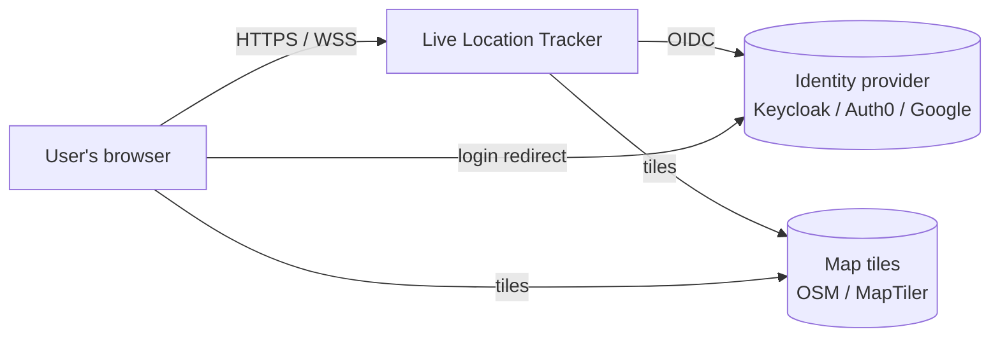
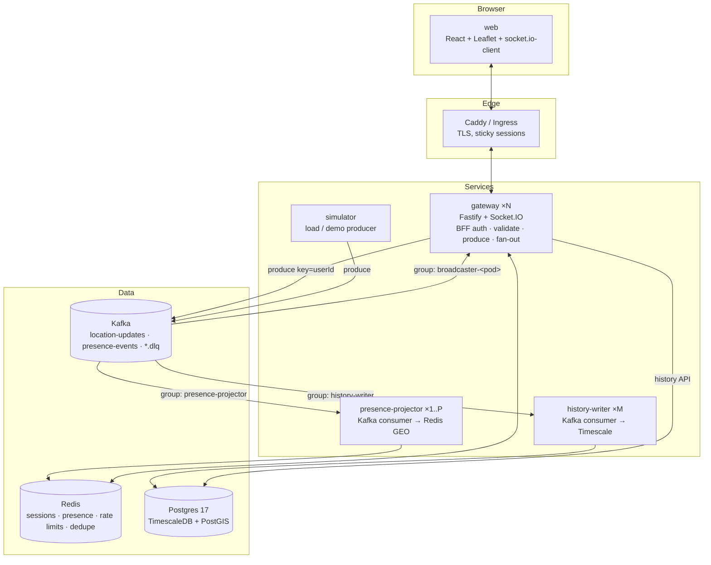
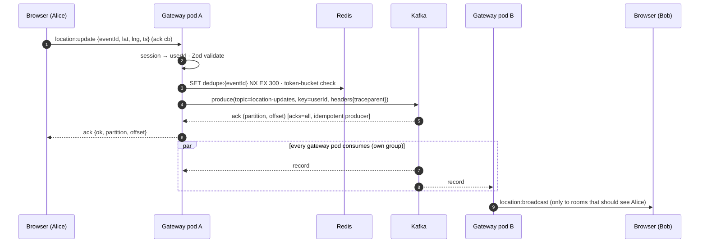
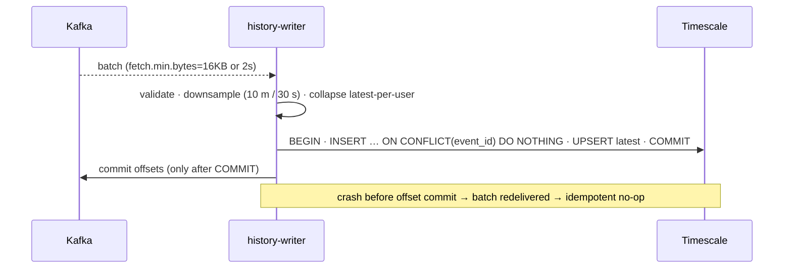

# 03 · System Architecture

## Context (C4 level 1)

## Containers (C4 level 2)

### Responsibilities

| Container | Owns | Does NOT do |
|---|---|---|
| **web** | UI, geolocation, send loop, map rendering | trust anything it receives without validating it |
| **gateway** | OIDC BFF endpoints, socket auth, validation, dedupe, rate limit, **produce**; consumes the topic to **fan out** to its own sockets | write to the DB; broadcast before Kafka acknowledges |
| **history-writer** | batched, downsampled, idempotent history writes; latest-position table | anything real-time |
| **presence-projector** | maintains the Redis presence view (GEO set + last-seen), emits `user.stale` events | socket I/O |
| **simulator** | synthetic riders straight into Kafka (demo + load) | bypass the contracts package |

> Why a separate **presence-projector** instead of each gateway keeping its own map (as the prototype does)? A newly started gateway can serve a correct `presence:snapshot` immediately from Redis, and stale detection runs **once** for the cluster instead of once per pod. Scaling is cheap: it's partitioned by userId like everything else.

## Hot path: one location update

**Latency budget (p99 500 ms):** validate + Redis 5 ms · produce with `acks=all` 10–30 ms · consumer poll ≤ 100 ms (`fetch.wait.max.ms=50–100`) · emit 5 ms · network both ways 100–200 ms.

## Cold path: history

## Failure modes (summary; detail in [09](09-observability-reliability.md))

| Failure | User impact | Behaviour |
|---|---|---|
| Postgres down | none on live map | history-writer pauses and lag grows; catches up on recovery (Kafka keeps 24–72 h) |
| Kafka broker lost (RF=3) | none | leader election; producer retries (idempotent, no duplicates) |
| Kafka cluster unavailable | sharing paused | gateway acks `{ok:false, retryable}`; client backs off; `/readyz` fails so new connections go elsewhere |
| Gateway pod dies | its sockets reconnect | Socket.IO auto-reconnect to another pod; session in Redis means no re-login |
| Redis down | rate limit/dedupe fail open; new logins fail | live updates continue (Kafka path); alerts fire |
| IdP down | new logins fail | existing sessions continue until they expire |
